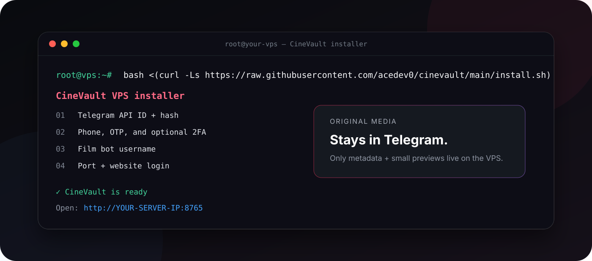
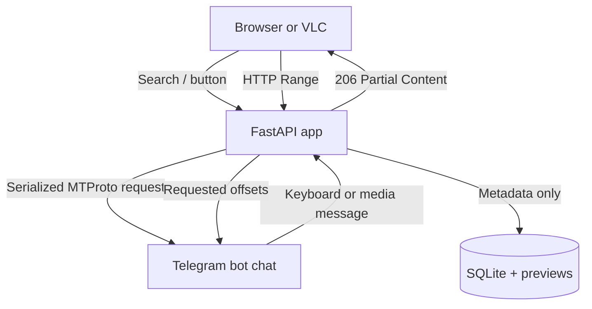

<p align="center">
  
</p>

<h1 align="center">CineVault</h1>

<p align="center"><strong>A cinematic Telegram FilmBot search and byte-range streaming website.<br>Original media stays in Telegram—not on your VPS.</strong></p>

<p align="center">
  <a href="https://github.com/acedev0/cinevault/actions/workflows/tests.yml"></a>
  <a href="https://github.com/acedev0/cinevault"></a>
  <a href="https://www.python.org/"></a>
  <a href="LICENSE"></a>
</p>

<p align="center">
  <a href="#one-line-vps-install"></a>
  <a href="https://replit.com/github/acedev0/cinevault"></a>
  <a href="https://github.com/acedev0/cinevault/archive/refs/heads/main.zip"></a>
  <a href="https://github.com/acedev0/cinevault/fork"></a>
</p>

CineVault signs into Telegram as your own user account, searches a configured film bot (default: `@FilterSECBot`), mirrors the bot's inline filters and pagination, and captures files the bot returns to the same private chat. The browser requests byte ranges from Telegram through your server, so seeking works without saving the complete original.

> [!IMPORTANT]
> Use CineVault only for media you own or are authorised to access and stream. CineVault is not affiliated with Telegram or FilterSEC and does not bypass memberships, payments, captchas, or other access controls.

## One-line VPS install

Run as `root` on Ubuntu, Debian, AlmaLinux, or Rocky Linux:

```bash
bash <(curl -Ls https://raw.githubusercontent.com/acedev0/cinevault/main/install.sh)
```

The installer asks for the Telegram API ID/hash, phone, OTP and optional 2FA, film-bot username, port, website username, and password. It then creates the service and prints the final URL.

<p align="center">
  
</p>

## Why CineVault

| Experience | What CineVault does |
| --- | --- |
| 🎬 Netflix-style discovery | Responsive portrait cards, hero artwork, one-page library, saved search, filters, infinite scroll, and shuffle |
| 🔎 Native bot workflow | Film-bot search, inline language/resolution/category filters, result buttons, and bot pagination remain on the website |
| ⚡ Range streaming | Sends `206 Partial Content` and downloads only the requested Telegram offsets for browser or VLC seeking |
| 💾 No original-media storage | Persists encrypted configuration, SQLite metadata, and small previews—not full source films |
| 🔐 Private or public | One command switches between password-protected and login-free access without changing Telegram credentials |
| 🖼️ Local portrait posters | Headless Chromium turns Telegram previews into cinematic 2:3 artwork without disclosing titles to metadata services |
| 🧹 Deletion consistency | Live events, reconciliation, and stream-time checks remove cards when their Telegram source disappears |
| 🛠️ VPS operations | `cinevaultctl` handles status, logs, health checks, modes, pruning, updates, auto-updates, and complete uninstall |

## How it works



Bot requests run through one transaction queue so concurrent searches cannot mix replies. Browser actions contain random server-side tokens rather than Telegram callback data. A result click is revalidated against the current Telegram message before CineVault clicks it.

### What lives where

| Data | Location | Stored on VPS? |
| --- | --- | --- |
| Original video/audio/file bytes | Telegram message | **No** |
| Catalogue title and message ID | SQLite | Yes |
| Telegram preview and portrait poster | Thumbnail directory | Yes, small files |
| API values and Telegram `StringSession` | Encrypted vault | Yes, encrypted |
| Website password | Argon2id hash | Yes, one-way hash |
| Active stream chunks | Memory/network response | Temporary only |

## Product tour

1. Search the bot from the top navigation.
2. Choose the bot's own filters, result, or pagination buttons.
3. Open the returned title from the one-page saved library.
4. Play in the custom browser player or copy a seven-day signed VLC link.
5. Let live Telegram deletion events remove unavailable media automatically.

### Player controls

The custom player includes speed, next/previous, autoplay-next, volume, captions, picture-in-picture, theatre mode, fullscreen, progress scrubbing, and Media Session integration.

| Keys | Action | Keys | Action |
| --- | --- | --- | --- |
| `Space` / `K` | Play or pause | `F` | Full screen |
| `←` / `→` | Seek ±5 seconds | `J` / `L` | Seek ±10 seconds |
| `↑` / `↓` | Volume | `M` | Mute |
| `T` | Theatre mode | `I` | Picture in picture |
| `Shift` + `,` / `.` | Playback speed | `N` / `P` | Next or previous |
| `0`–`9` | Jump by percentage | `Home` / `End` | Start or end |

The complete walkthrough is in the [User guide](docs/USER_GUIDE.md).

## Deploy

### VPS + systemd

Use the [one-line installer](#one-line-vps-install), or clone/extract the repository and run:

```bash
chmod +x install.sh
sudo ./install.sh
```

The default port is `8765`. The installer creates:

| Resource | Default path |
| --- | --- |
| Application | `/opt/cinevault/app` |
| Python environment | `/opt/cinevault/.venv` |
| Private state | `/var/lib/cinevault` |
| Management command | `/usr/local/bin/cinevaultctl` |
| Service | `cinevault.service` |

### Replit

Use the **Open in Replit** button above, open **Shell**, and run `bash scripts/replit-run.sh`. The first run performs the interactive setup. Store the generated `data/` directory privately and never commit it.

### Docker Compose

Telegram login needs an interactive terminal once:

```bash
docker compose build
docker compose run --rm -it cinevault python -m cinevault --data-dir /data setup
docker compose up -d
```

Open `http://SERVER-IP:8765`.

## Manage and update

```bash
cinevaultctl status
cinevaultctl logs
sudo cinevaultctl doctor
sudo cinevaultctl restart
sudo cinevaultctl prune
sudo cinevaultctl mode public
sudo cinevaultctl mode private
sudo cinevaultctl update
sudo cinevaultctl auto-update enable
```

Updates preserve `/var/lib/cinevault`, including the encrypted Telegram session, API credentials, website login, selected port, database, and previews.

To immediately remove the service **and all private CineVault data**:

```bash
sudo cinevaultctl uninstall --yes
```

This does not delete anything from Telegram. See [Deployment](docs/DEPLOYMENT.md) for backups, ZIP-only updates, firewalls, and remote access.

## Direct VLC links and file support

**Copy VLC link** creates an HMAC-signed bearer URL that supports `GET`, `HEAD`, HTTP Range, and seeking for seven days without a browser cookie. Anyone holding the URL can stream that item until expiry, so handle it like a temporary password.

CineVault can relay MKV, MP4, AVI, TS, WebM, audio, subtitles, archives, photos, and general Telegram documents. Transport support and browser decoding are different: MP4 with H.264/AAC has the broadest browser compatibility; unsupported containers/codecs can be opened through the signed VLC link.

Universal YouTube-style transcoding would require sustained CPU and usually segment storage, so CineVault deliberately relays source bytes instead.

## Security model

- Telegram API values and the `StringSession` are encrypted at rest with a local `0600` master key.
- Website passwords use Argon2id; logins are rate-limited and state changes require CSRF tokens.
- Session cookies are HTTP-only, same-site, and expire after 12 hours.
- Signed player URLs use a separate HMAC secret and bounded expiry.
- State-changing Telegram buttons are stored server-side behind random opaque tokens.
- Poster rendering is local and does not send catalogue titles to a third-party metadata service.
- The service runs as an isolated account with a hardened systemd unit and a writable private-data directory only.

HTTP is supported, but it does not encrypt passwords or streams in transit. Prefer a private VPN, SSH tunnel, or HTTPS reverse proxy when traffic crosses an untrusted network.

Never commit `/var/lib/cinevault`, local `data/`, `.master_key`, `secrets.enc`, `runtime.env`, SQLite databases, Telegram sessions, or signed stream links.

## Documentation

| Guide | Contents |
| --- | --- |
| [User guide](docs/USER_GUIDE.md) | Search, library, player, VLC, modes, and daily management |
| [Deployment](docs/DEPLOYMENT.md) | VPS, Replit, Docker, firewall, update, backup, and uninstall |
| [Architecture](docs/ARCHITECTURE.md) | Components, transactions, deduplication, deletions, and byte ranges |
| [Troubleshooting](docs/TROUBLESHOOTING.md) | Diagnostics and common recovery paths |
| [Security](SECURITY.md) | Threat model and private disclosure process |
| [Contributing](CONTRIBUTING.md) | Development setup and contribution rules |

## Local development

```bash
python3 -m venv .venv
source .venv/bin/activate
python -m pip install -r requirements-dev.txt
python -m pytest -q
./start.sh
```

The CI workflow tests Python 3.10, 3.12, and 3.13 and validates the JavaScript poster/player sources on every push and pull request.

## License

CineVault is released under the [MIT License](LICENSE).
