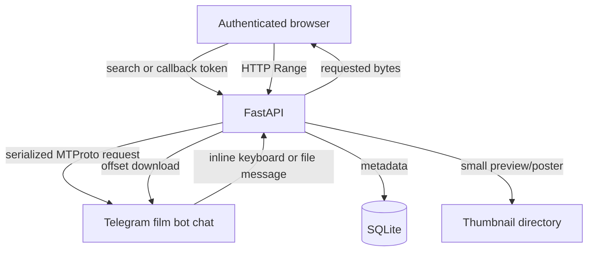

# CineVault architecture

## Data path

Original film bytes pass through memory buffers and the network response. They are not written to the VPS filesystem. Persistent state is limited to encrypted credentials/session data, SQLite metadata, and small preview images.

## Components

| Component | Responsibility |
| --- | --- |
| `cinevault/app.py` | Authentication, CSRF/rate limits, HTML/API routes, source checks, thumbnails, and HTTP range responses |
| `cinevault/film_bot.py` | Telethon connection, serialized bot searches/callbacks, opaque button mapping, file waiting, deletion events, and Telegram byte downloads |
| `cinevault/indexer.py` | Returned-file metadata extraction, MKV/document recognition, deduplication, thumbnails, and deletion reconciliation |
| `cinevault/posters.py` | Bounded background orchestration for the optional Puppeteer poster worker |
| `cinevault/database.py` | SQLite media catalog, deterministic random order, reconciliation scheduling, and atomic record deletion |
| `cinevault/config.py` | Encrypted configuration and Telegram StringSession storage |
| `cinevault/static/` | One-page discovery/library interface and custom video controls |

## Bot transaction isolation

Telegram bots reply asynchronously and may edit an existing keyboard for filters or pagination. CineVault therefore protects the complete send/click/wait cycle with one async lock. A browser receives only random page/action tokens. The server maps each token to an exact Telegram message, row, and column, re-fetches the message, verifies its fingerprint, and only then clicks it.

URL, payment, phone-sharing, and other non-callback buttons are not exposed. CineVault does not complete access gates or bypass bot controls.

## File capture and deduplication

A result click records the newest incoming file message after the callback baseline. Media is deduplicated by Telegram's document/photo identifier within the bot chat. Documents are classified as video, audio, or general files by Telegram metadata, MIME type, and extension. Existing video/photo databases are rebuilt in place to extend the kind constraint while preserving record IDs.

## Deletion consistency

Three paths converge on the same deletion routine:

1. A Telegram `MessageDeleted` update removes matching records immediately when received.
2. A periodic, rotating reconciliation batch re-fetches stored message IDs and removes missing entries.
3. Every watch or stream request re-fetches its exact source message; a missing source returns HTTP 410 and removes the record and thumbnail.

## Range streaming

Single HTTP byte ranges are parsed strictly. CineVault returns `206`, `Content-Range`, `Content-Length`, and `Accept-Ranges` for partial responses; malformed or impossible ranges receive `416`. Telegram requests use aligned 512 KiB chunks through Telethon's offset downloader, with only the requested bytes yielded to the browser.

Browser container/codec support is independent of the range transport. MKV can be relayed but may require the original-file fallback and an external player.

Signed VLC links use an HMAC over the media id and expiry. They need no session cookie, accept normal byte ranges, expire after at most 30 days, and are revoked automatically when the source Telegram message disappears.
